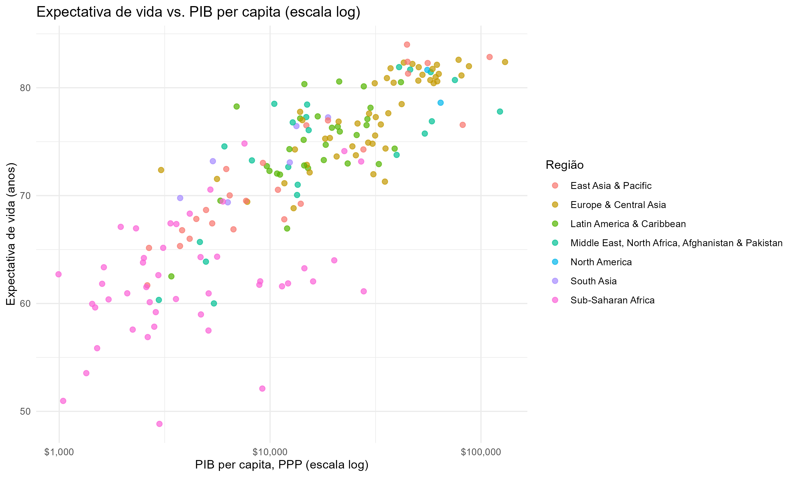
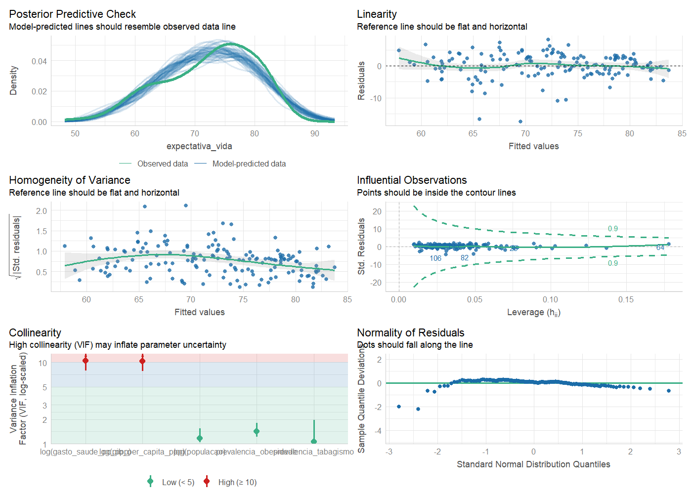

# 🌎 Health Inequality Explorer

Análise de desigualdades de saúde entre 159 países, em **R** (coleta, estatística, aprendizado de máquina) e um **dashboard interativo** em HTML/CSS/JavaScript. O projeto responde a duas perguntas ao mesmo tempo: uma de **domínio** (o que explica as diferenças de saúde entre países?) e uma de **visualização** (as técnicas de projeção PCA, t-SNE e UMAP mostram os mesmos grupos de países?).

**[→ Abrir o dashboard](https://thaiiceu.github.io/health-inequality-explorer/)** · **[→ Rascunho do artigo](docs/ARTIGO.md)** · **[→ Metodologia completa](docs/METODOLOGIA.md)**


*Os mesmos 159 países, com os mesmos grupos (cores), projetados em 2 dimensões por três técnicas. Os grupos são os mesmos nas três imagens; o que muda é o quanto cada técnica os separa visualmente.*

---

## Resultados em 30 segundos

- **Renda pesa muito, mas não explica tudo.** Dobrar o PIB per capita está associado a cerca de **+2,4 anos** de expectativa de vida (mantidos os demais fatores). O modelo explica 72,8% da variação (R² ajustado).
- **Quatro perfis de países** emergem da clusterização, de "alta longevidade" (56 países, 79,2 anos em média) a "mortalidade infantil muito elevada" (34 países, 61,7 anos).
- **Nenhuma projeção é a melhor em tudo.** O PCA preserva melhor os vizinhos reais (continuity 0,977); o t-SNE evita melhor os falsos vizinhos (trustworthiness 0,977); UMAP e t-SNE ficam próximos na separação visual dos grupos.
- **O número de grupos depende do algoritmo.** Cinco algoritmos de agrupamento concordam apenas de forma moderada a baixa entre si (ARI entre 0,33 e 0,72 em relação ao K-Means): os países formam mais um contínuo do que blocos separados.
- **O Sul da África aparece abaixo do esperado** (Eswatini, Lesoto, Botsuana, África do Sul, Zimbábue), compatível com o impacto do HIV/AIDS, que o modelo não captura.

---

## Pergunta principal

Em que medida indicadores socioeconômicos e de acesso ao sistema de saúde explicam as diferenças nos resultados de saúde entre países, e quais países apresentam desempenho acima ou abaixo do esperado dado seu nível de desenvolvimento?

**Perguntas secundárias**

1. Quais indicadores estão mais associados à expectativa de vida?
2. Existem agrupamentos naturais de países com perfis semelhantes?
3. Quais países superam ou ficam abaixo do esperado, controlando pelo nível socioeconômico?
4. A relação entre desenvolvimento e mortalidade infantil segue o mesmo padrão da expectativa de vida?
5. Quanto da variação em saúde pode ser resumida em poucas dimensões (PCA)?
6. **(Visualização)** As projeções PCA, t-SNE e UMAP mostram a mesma estrutura de grupos? O resultado depende do algoritmo de agrupamento, dos parâmetros ou das variáveis escolhidas?

---

## Dados

Nove indicadores coletados por API de duas fontes oficiais, entre 2000 e 2022.

| Indicador | Fonte | Código | Papel |
|---|---|---|---|
| Expectativa de vida ao nascer | WHO GHO | `WHOSIS_000001` | núcleo |
| Mortalidade infantil (<5 anos) | WHO GHO | `MDG_0000000007` | núcleo |
| Prevalência de obesidade (adultos) | WHO GHO | `NCD_BMI_30A` | núcleo |
| PIB per capita (PPP) | World Bank | `NY.GDP.PCAP.PP.KD` | núcleo |
| População total | World Bank | `SP.POP.TOTL` | núcleo (controle de escala) |
| Gasto em saúde per capita (PPP) | World Bank | `SH.XPD.CHEX.PP.CD` | núcleo |
| Prevalência de tabagismo (adultos) | World Bank | `SH.PRV.SMOK` | núcleo |
| Médicos por 10.000 habitantes | WHO GHO | `HWF_0001` | secundário |
| Escolaridade esperada | World Bank | `SE.SCH.LIFE` | secundário |

O **núcleo** (7 indicadores) tem boa cobertura simultânea e forma a amostra principal: **159 países em 2015**. Os dois **secundários** têm cobertura bem menor (apenas 74 países quando exigidos juntos) e entram só em checagens de robustez.

---

## Passo a passo da análise

Cada etapa abaixo corresponde a um script em `R/`. A ordem importa: cada script lê o que o anterior gravou em `data/processed/`.

### 1. Coletar os dados · `R/01_coleta_dados.R`

**O que faz.** Baixa os indicadores das APIs da WHO e do World Bank para todos os anos de 2000 a 2022 e registra a origem de cada um num manifesto (`data/raw/manifesto_coleta.csv`).
**Por quê.** Baixar todos os anos permite escolher o ano de referência com base em evidência (cobertura), e não por conveniência. A busca de indicadores da WHO é feita por nome e não só por código fixo, porque a própria WHO anunciou mudanças na API.
**Resultado.** Dados brutos reproduzíveis (a pasta `data/raw/` não é versionada; basta rodar o script de novo).

### 2. Limpar e escolher o ano · `R/02_limpeza_dados.R`

**O que faz.** Junta as duas fontes por **código ISO3** (e não pelo nome do país, que cada fonte escreve de um jeito), resolve duplicidades (prefere "ambos os sexos" e a revisão mais recente) e mede quantos países têm todos os indicadores em cada ano.
**Por quê.** Sem a chave ISO3, países como "Russian Federation" e "Russia" virariam dois. A cobertura define o ano de referência.
**Resultado.** **2015** foi escolhido, com **159 países** completos no núcleo (empatado com 2020, que foi descartado porque a pandemia distorce a expectativa de vida e a mortalidade).


### 3. Explorar os dados · `R/03_analise_exploratoria.R`

**O que faz.** Histogramas, dispersões, boxplots por região e matriz de correlação.
**Por quê.** Antes de modelar, é preciso conhecer as formas das distribuições e as relações entre as variáveis.
**Resultado.** PIB, gasto em saúde e mortalidade infantil são muito assimétricos, então entram em **logaritmo** nas análises. A relação entre renda e expectativa de vida tem retornos decrescentes: o mesmo aumento de renda rende mais anos de vida nos países mais pobres. Correlações de atenção: PIB × gasto em saúde = **0,86** (risco de colinearidade); mortalidade infantil × expectativa de vida = **−0,80**.



### 4. Regressão: o que se associa à expectativa de vida · `R/04_analise_estatistica.R`

**O que faz.** Ajusta uma regressão múltipla da expectativa de vida sobre log(PIB), obesidade, tabagismo, log(população) e log(gasto em saúde), e testa se o modelo é válido (normalidade, heterocedasticidade, colinearidade, observações influentes).
**Por quê.** Os testes mostraram resíduos não normais e heterocedásticos, então todos os p-valores usam **erros-padrão robustos (HC3)**. O VIF de PIB e gasto em saúde (≈ 10) indica colinearidade, tratada com uma especificação alternativa.
**Resultado.** R² ajustado = **0,728** (N = 159).

| Variável | Coeficiente | Erro-padrão (HC3) | p |
|---|---|---|---|
| log(PIB per capita) | **3,50** | 1,24 | **0,005** |
| Tabagismo | 0,080 | 0,031 | 0,011 |
| log(gasto em saúde) | 1,80 | 0,98 | 0,069 |
| log(população) | 0,20 | 0,19 | 0,298 |
| Obesidade | 0,001 | 0,033 | 0,968 |

O gasto em saúde só tem associação marginal depois de descontar o PIB. O tabagismo tem sinal **positivo**, o que não é efeito causal: países ricos fumaram muito no passado e hoje vivem mais por outros motivos. Tudo isso é associação, não causa.



### 5. PCA: resumir seis variáveis em duas · `R/05_pca_clusterizacao.R`

**O que faz.** Padroniza os 6 indicadores de perfil (z-score, com log em mortalidade, PIB e gasto) e calcula os componentes principais.
**Por quê.** O PCA transforma variáveis correlacionadas em poucos eixos independentes, o que permite ver os países num plano.
**Resultado.** **PC1 = 65,9%** da variância (eixo geral de desenvolvimento) e **PC2 = 15,5%** (quase só tabagismo). Juntos: 81,4%. O critério de Kaiser sugeriria só 1 componente; mantivemos 2 pela interpretação clara do PC2 (decisão de julgamento, documentada).


### 6. Agrupar os países em perfis · `R/05_pca_clusterizacao.R`

**O que faz.** Agrupa os países por K-Means (K = 4) e confere o resultado com clusterização hierárquica (Ward).
**Por quê.** K = 4 foi escolhido em vez do K = 2 "ótimo" pela silhueta porque oferece perfis mais ricos e interpretáveis. Os nomes dos grupos são descritivos e ordenados pela expectativa de vida, sem juízo de valor.
**Resultado.**

| Grupo | Países | Expectativa de vida | Mortalidade infantil (por 1.000) | PIB per capita (US$) | Exemplos |
|---|---|---|---|---|---|
| 1. Alta longevidade e baixa mortalidade infantil | 56 | 79,2 | 5,4 | 48.753 | Portugal, Coreia do Sul, Israel |
| 2. Transição intermediária de desenvolvimento | 52 | 73,3 | 18,7 | 15.691 | Egito, Argélia, Azerbaijão |
| 3. Mortalidade infantil elevada, baixa prevalência de obesidade | 17 | 67,7 | 39,4 | 5.185 | Laos, Índia, Nepal |
| 4. Mortalidade infantil muito elevada, indicadores de renda mais baixos | 34 | 61,7 | 75,1 | 3.651 | Uganda, Tanzânia, Costa do Marfim |

A obesidade não acompanha o desenvolvimento de forma linear: os grupos 3 e 4 têm obesidade de 9% a 11%, contra 22% a 25% nos grupos 1 e 2 (transição epidemiológica).

### 7. Esperado vs. observado · `R/06_modelagem.R`

**O que faz.** Usa o modelo do passo 4 para prever a expectativa de vida de cada país e compara com o valor real, pelo **resíduo studentizado** (corrige a heterocedasticidade). Acima de +1 desvio-padrão: "acima do esperado"; abaixo de −1: "abaixo".
**Por quê.** Revela países que se afastam do que a renda e os demais fatores previam.
**Resultado.** 19 países acima, 120 dentro e 20 abaixo do esperado, perto do teórico (16% / 68% / 16%). Os cinco mais abaixo são **Eswatini, Lesoto, Botsuana, África do Sul e Zimbábue**, a região mais atingida pelo HIV/AIDS, fator que o modelo não tem. Entre os acima: Peru, Cabo Verde, Etiópia, Costa Rica, Jordânia e Bangladesh. Isso não é um veredito sobre a qualidade do sistema de saúde de nenhum país.


### 8. Exportar para o dashboard · `R/07_exportacao_dashboard.R`

**O que faz.** Converte os resultados em arquivos JSON estáticos em `dashboard/data/` (KPIs, países, clusters, PCA, regressão, série temporal, matriz de calor).
**Por quê.** O dashboard não precisa de servidor nem de R: lê os JSONs e desenha tudo no navegador.

### 9. Checar se o resultado vale para outro ano · `R/08_sensibilidade_ano.R`

**O que faz.** Refaz regressão, PCA e K-Means para **2010** e compara com 2015.
**Resultado.** A estrutura se mantém: R² ajustado 0,683 (2010) contra 0,728 (2015); PC1 e PC2 explicam 66,0% e 16,0% (contra 65,9% e 15,5%); o PIB continua significativo (p = 0,019 contra 0,005). O gasto em saúde passa a ser significativo em 2010 (p = 0,042), mas só marginal em 2015 (p = 0,069), ou seja, esse resultado é frágil.

### 10. Comparar projeções e algoritmos de agrupamento · `R/09_projecoes_clusterizacao.R`

Esta é a parte de **visualização** do projeto: uma comparação medida (e não só visual) de PCA, t-SNE e UMAP.

**O que faz.**
1. Define os grupos **no espaço original de 6 dimensões** (nunca nas coordenadas da projeção), para não favorecer o PCA por construção.
2. Projeta os países com PCA, t-SNE (perplexity 15) e UMAP (`n_neighbors` 15).
3. Mede a qualidade de cada projeção: **trustworthiness** (poucos "falsos vizinhos"), **continuity** (poucos vizinhos reais separados), **vizinhos do mesmo grupo** e **silhueta 2D**.
4. Repete t-SNE e UMAP com 10 sementes e varia os hiperparâmetros (5, 15, 30, 45).
5. Compara cinco algoritmos de agrupamento (K-Means, Ward, PAM, GMM, HDBSCAN) pelo índice de Rand ajustado (ARI).
6. Remove uma variável por vez e testa a inclusão das duas secundárias.

**Resultados.**

*Qualidade das projeções* (semente 42; entre parênteses, média de 10 sementes para t-SNE e UMAP):

| Técnica | Trustworthiness | Continuity | Vizinhos do mesmo grupo | Silhueta 2D |
|---|---|---|---|---|
| Espaço original (6D) | 1,000 | 1,000 | 0,903 | 0,332 |
| PCA | 0,942 | **0,977** | 0,927 | 0,444 |
| t-SNE | **0,982** (0,977) | 0,963 (0,965) | 0,934 (0,934) | **0,499** (0,481) |
| UMAP | 0,957 (0,965) | 0,973 (0,970) | **0,940** (0,942) | 0,487 (0,504) |

- **Nenhuma técnica vence em tudo.** O melhor valor muda de coluna para coluna, e t-SNE e UMAP variam entre sementes. Concluir a partir de uma única execução seria um erro.
- A silhueta 2D (0,44 a 0,50) supera a do espaço original (0,33): as projeções **exageram a separação** entre grupos que, em 6D, se tocam.

*Sensibilidade aos parâmetros.* O ARI entre os grupos refeitos em 2D e os de 6D vai de **0,52 a 0,90** no t-SNE e de **0,56 a 0,88** no UMAP, enquanto o PCA (sem parâmetros) dá **0,96**. A estrutura de grupos vista num único gráfico t-SNE ou UMAP pode mudar muito com a escolha do parâmetro.


*Algoritmos de agrupamento* (concordância com o K-Means, ARI):

| Algoritmo | Grupos | Sem grupo (ruído) | Silhueta 6D | ARI vs. K-Means |
|---|---|---|---|---|
| K-Means | 4 | 0 | 0,332 | 1,00 |
| Ward | 4 | 0 | 0,318 | 0,72 |
| PAM | 4 | 0 | 0,294 | 0,53 |
| GMM | 4 | 0 | 0,220 | 0,33 |
| HDBSCAN | 2 | 38 países | 0,516* | 0,33 |

\* calculada sem os países de ruído, por isso não é comparável às demais. O número de grupos é uma propriedade do método e não dos dados.

*Influência das variáveis* (K-Means, ARI contra o agrupamento completo ao remover cada variável): tabagismo **0,60**, gasto em saúde 0,71, PIB 0,79, obesidade 0,90, expectativa de vida 0,93, mortalidade infantil 0,96. O **tabagismo** é a variável que mais molda os grupos. Incluir escolaridade e médicos (74 países) muda os grupos (ARI 0,70) e **piora** a separação (silhueta de 0,376 para 0,324).

*Sobre reprodutibilidade:* t-SNE, UMAP e HDBSCAN dependem de sementes e de versões de pacote. Numa execução em outro ambiente, o HDBSCAN encontrou 3 grupos e 46 países de ruído em vez de 2 e 38. Por isso o projeto oferece o `renv` para travar as versões e reporta variações entre sementes.

### 11. Dashboard interativo · `dashboard/`

Sete seções, cada uma com a explicação de como ler o gráfico: visão geral, comparação de países, perfis de saúde (PCA, mapa de calor país × indicador e comparador de projeções), regressão, esperado vs. observado, mapa mundial e metodologia.


*Mapa de calor: cada linha é um país, cada coluna um indicador; verde = situação mais favorável (em mortalidade infantil, obesidade e tabagismo a escala é invertida, marcada com asterisco), faixa lateral = grupo.*


*Comparador de projeções: escolha a técnica, o algoritmo que colore os pontos e destaque um país nas três projeções ao mesmo tempo.*

---

## Tecnologias

**Análise**: R (tidyverse, httr2, jsonlite, broom, performance, sandwich, lmtest, factoextra, cluster, corrplot, Rtsne, uwot, mclust, dbscan)
**Dashboard**: HTML, CSS, JavaScript, [D3.js](https://d3js.org/) (mapa, matrizes, projeções), [Chart.js](https://www.chartjs.org/) (gráficos)
**Arquitetura**: o R processa e exporta JSON estático; o front-end lê com `fetch()`; hospedagem gratuita no GitHub Pages, sem servidor.

---

## Como reproduzir

**A. Só ver o dashboard (sem R)**

Os JSONs já estão no repositório. Clone ou baixe o ZIP (*Code → Download ZIP*) e, na pasta do projeto:

```bash
cd dashboard
python -m http.server 8000
# abra http://localhost:8000 no navegador
```

(`fetch()` não funciona abrindo o `index.html` com duplo clique; é preciso um servidor local, como acima, ou o link do GitHub Pages.) No Windows, se `python` não funcionar, tente `py -m http.server 8000`. Alternativa: abrir a pasta `dashboard/` no VS Code e usar a extensão *Live Server*.

**B. Refazer a análise (com R)**

Abra o projeto no RStudio, com a raiz do repositório como diretório de trabalho. Há duas formas de instalar os pacotes.

**Com renv** (recomendado, trava as versões dos pacotes): rode uma vez `source("R/00_configurar_renv.R")`. Ele cria o ambiente, roda os scripts 01 a 07 e grava o `renv.lock`. Depois de commitar o `renv.lock`, qualquer pessoa reproduz o mesmo ambiente com:

```r
install.packages("renv")
renv::restore()
```

**Sem renv**:

```r
install.packages(c("httr2", "jsonlite", "dplyr", "readr", "purrr", "stringr",
                   "tidyr", "ggplot2", "corrplot", "scales", "broom",
                   "performance", "sandwich", "lmtest", "factoextra",
                   "cluster", "ggrepel", "Rtsne", "uwot", "mclust", "dbscan"))
```

Depois, rode os scripts em ordem:

```r
source("R/01_coleta_dados.R")            # coleta via API (precisa de internet)
source("R/02_limpeza_dados.R")
source("R/03_analise_exploratoria.R")
source("R/04_analise_estatistica.R")
source("R/05_pca_clusterizacao.R")
source("R/06_modelagem.R")
source("R/07_exportacao_dashboard.R")    # gera os JSONs do dashboard
source("R/08_sensibilidade_ano.R")
source("R/09_projecoes_clusterizacao.R") # projeções e algoritmos (~20 s)
```

Os dados já processados estão em `data/processed/`; se quiser apenas a comparação de projeções, rode só o `09`.

---

## Estrutura do repositório

```
health-inequality-explorer/
├── README.md
├── renv.lock, renv/            # versões travadas dos pacotes R (gerados por 00_configurar_renv.R)
├── .github/workflows/pages.yml # publica o dashboard no GitHub Pages
├── data/
│   ├── raw/                    # dados brutos da API (não versionado)
│   ├── processed/              # dados limpos, com clusters e projeções
│   └── external/               # referência de países (World Bank)
├── R/
│   ├── funcoes.R               # funções reutilizáveis
│   ├── 00_configurar_renv.R    # roda uma vez, trava as versões
│   ├── 01 … 07                 # pipeline principal
│   ├── 08_sensibilidade_ano.R  # robustez: 2010 vs. 2015
│   └── 09_projecoes_clusterizacao.R  # PCA vs. t-SNE vs. UMAP + 5 algoritmos
├── dashboard/                  # index.html, css/, js/, img/ e data/ (JSONs)
├── outputs/
│   ├── figures/                # gráficos gerados pelos scripts
│   └── tables/                 # tabelas de resultados
└── docs/
    ├── METODOLOGIA.md          # decisões e números de cada etapa
    ├── ARTIGO.md               # rascunho do artigo
    └── img/                    # capturas do dashboard
```

---

## Limitações

- Corte transversal de um ano: não captura tendências individuais por país.
- 159 dos ~217 países, por exigência de cobertura simultânea dos indicadores.
- Desenho observacional: correlação não implica causalidade em nenhuma das análises.
- Sem variáveis de carga de doença específica (HIV/AIDS, conflitos, desastres).
- A comparação de projeções usa um único conjunto de dados, 6 variáveis e K = 4 herdado da análise de domínio; o ARI e a silhueta comparam métodos entre si, sem gabarito de grupos.
- Resultados de t-SNE, UMAP e HDBSCAN dependem de sementes, parâmetros e versões de pacote.

## Próximos passos

- Adicionar mais anos para uma análise de painel.
- Avaliar a estabilidade dos grupos por reamostragem (*bootstrap*).
- Incluir outras técnicas (PaCMAP, coordenadas paralelas) e testar em conjuntos com grupos conhecidos.
- Estudar com usuários se as diferenças de métricas mudam a interpretação visual.

---

## Autoria

Projeto desenvolvido como peça de portfólio em Estatística e Data Science e como trabalho da disciplina *Tópicos Avançados em Visualização de Informação* (UNESP, PPGCC).
