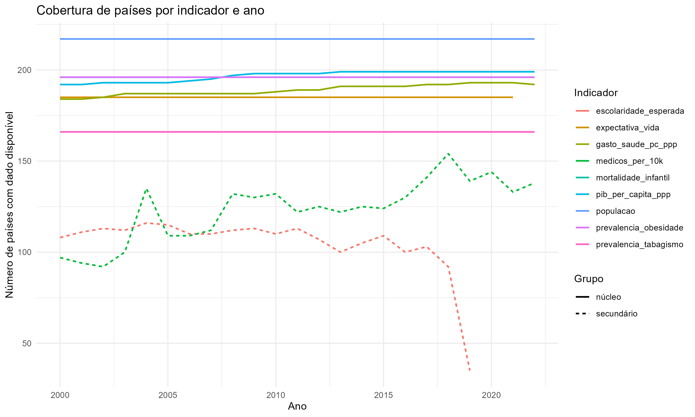
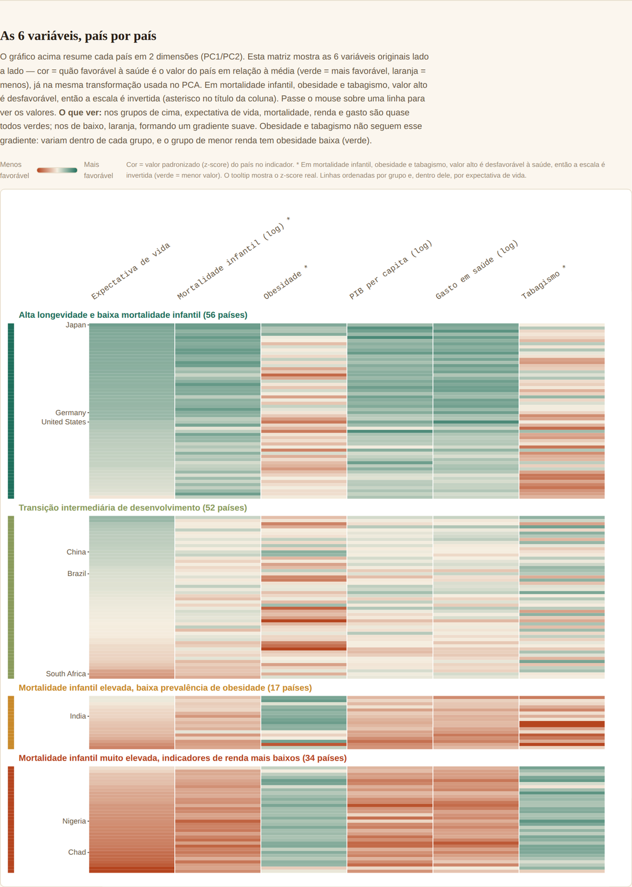
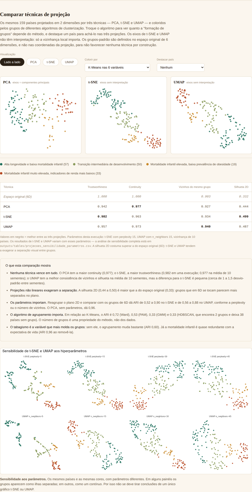
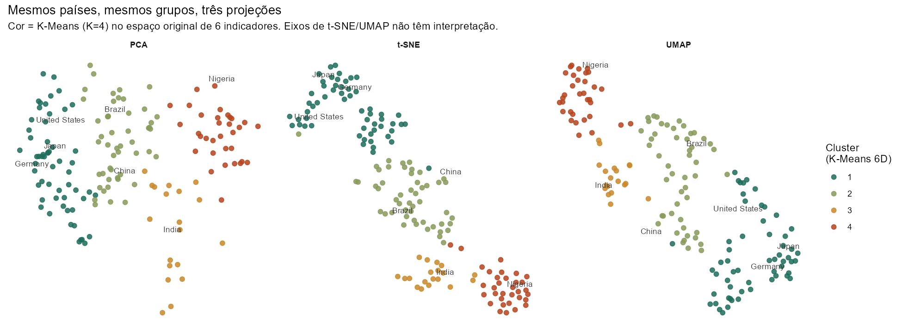
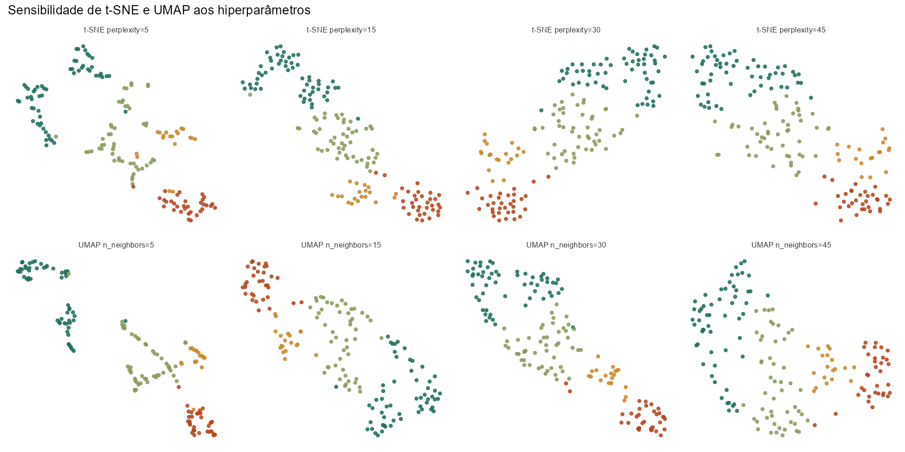
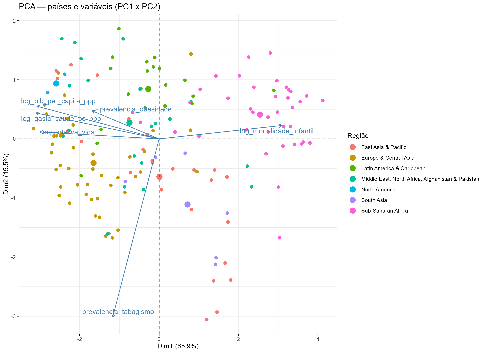
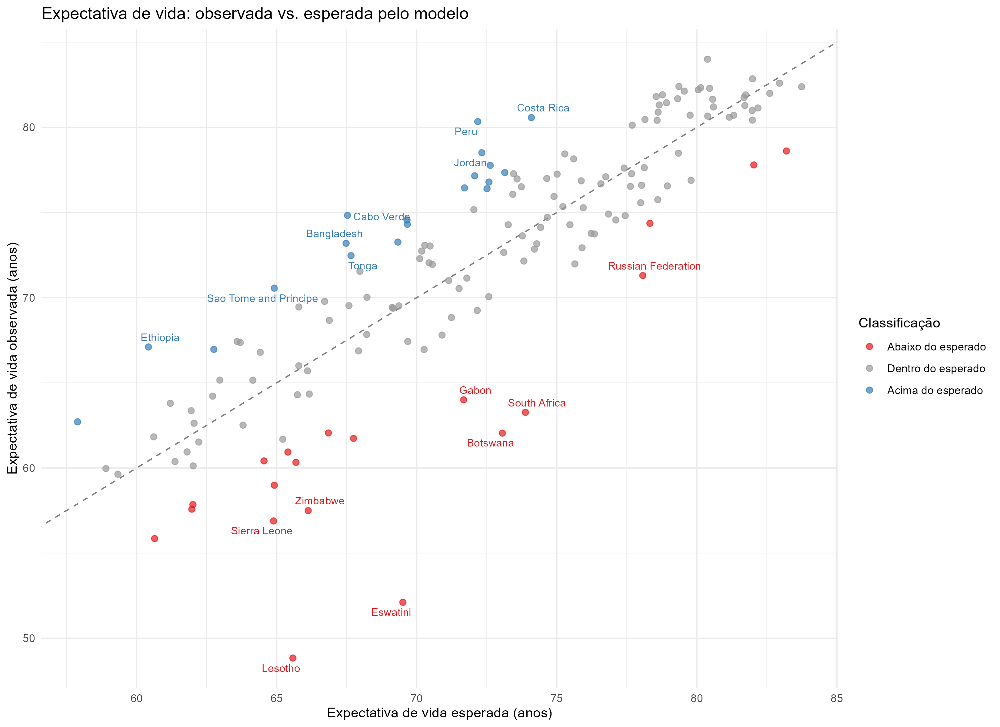

# Comparação de técnicas de projeção e de algoritmos de agrupamento na exploração visual de desigualdades de saúde entre países

> **Rascunho** nas 5 seções exigidas pela disciplina, pronto para colar no template IEEE (https://www.ieee.org/conferences_events/conferences/publishing/templates.html). Todos os números abaixo vêm de execuções reais dos scripts `R/04` a `R/09` sobre os dados do projeto (N = 159 países, ano de referência 2015) e conferem com as tabelas de `outputs/tables/`. As figuras estão em `outputs/figures/` e `docs/img/` e aparecem aqui com os mesmos nomes de arquivo. Faltam: nome(s) do(s) autor(es) e afiliação, resumo/abstract, figuras no formato do template e conferência final das referências.

---

## Resumo (Abstract)

*(escrever por último, 150–250 palavras: pergunta, método, achado principal — nenhuma projeção domina as demais e o número de grupos depende do algoritmo —, e limitação principal.)*

**Palavras-chave:** visualização de dados multivariados; redução de dimensionalidade; PCA; t-SNE; UMAP; agrupamento; desigualdade em saúde.

---

## I. Introdução

Projeções bidimensionais de dados multivariados são uma das ferramentas mais usadas em exploração visual: reduzem muitos atributos a um plano onde o olhar humano identifica agrupamentos e exceções. Mas a impressão visual de "grupos" depende da técnica de projeção, de seus hiperparâmetros e do algoritmo que define os grupos, e raramente essa dependência é medida. Este trabalho compara três técnicas de projeção — PCA, t-SNE e UMAP — e cinco algoritmos de agrupamento sobre um conjunto de dados real: seis indicadores de saúde e desenvolvimento de 159 países, obtidos da WHO e do World Bank.

O trabalho se enquadra no **Segundo Caso** da disciplina (exploração de um conjunto de dados de um domínio por meio de um sistema de visualização construído com bibliotecas existentes — D3.js e Chart.js). Além de comparar as técnicas, o sistema resultante, o **Health Inequality Explorer**, permite ao usuário alternar projeção e algoritmo e destacar um país nas três projeções simultaneamente.

As perguntas orientadoras são:

1. Qual técnica (PCA, t-SNE ou UMAP) preserva melhor a vizinhança local dos países e separa melhor os grupos?
2. Os grupos encontrados dependem do algoritmo de agrupamento escolhido?
3. Quais indicadores mais influenciam a formação dos grupos, e o que acontece ao removê-los ou ampliá-los?
4. Como o domínio de aplicação responde: quais fatores se associam à expectativa de vida e quais países ficam acima ou abaixo do esperado?

A Seção II apresenta a fundamentação teórica; a Seção III descreve o sistema; a Seção IV traz os resultados; a Seção V conclui.

---

## II. Fundamentação Teórica

### A. Visualização de informação e o pipeline de visualização

O propósito da visualização é o *insight* — descobertas, verificação de hipóteses, tomada de decisão — e não as imagens em si [1]. Adotamos o modelo de pipeline de Card, Mackinlay e Shneiderman [2]: dados brutos → tabelas de dados → estruturas visuais → vistas, com interação do usuário podendo atuar em cada etapa. Na interação, seguimos o princípio *overview first, zoom and filter, details on demand* [3].

### B. Técnicas de projeção para dados multivariados

Dentro da taxonomia de técnicas para dados multivariados [4], as projeções geométricas mapeiam um espaço de muitas dimensões em um espaço de poucas dimensões:

- **PCA** [5]: projeção linear que maximiza a variância retida. Determinística; os eixos (componentes) são combinações lineares interpretáveis das variáveis originais.
- **t-SNE** [6]: projeção não linear que preserva vizinhanças locais, minimizando a divergência entre distribuições de similaridade no espaço original e no plano. Depende da perplexity e de inicialização aleatória; os eixos não têm interpretação, e distâncias entre grupos distantes não são confiáveis [7].
- **UMAP** [8]: projeção não linear baseada em grafo de vizinhos e topologia fuzzy; depende de `n_neighbors` e `min_dist` e de inicialização aleatória; os mesmos cuidados de leitura do t-SNE se aplicam.

### C. Avaliação de projeções

Como "parecer bom" é subjetivo, medimos a qualidade da projeção. **Trustworthiness** e **continuity** [9] quantificam a preservação da vizinhança local: a primeira penaliza "falsos vizinhos" (pontos próximos no plano mas distantes no espaço original); a segunda penaliza vizinhos reais separados pela projeção; ambas valem de 0 a 1. Também medimos a **silhueta** [10] dos grupos no plano e a **fração dos 10 vizinhos mais próximos que pertencem ao mesmo grupo**. Usamos k = 10 vizinhos.

### D. Algoritmos de agrupamento e concordância

Cada algoritmo assume uma forma de grupo: K-Means e Ward (hierárquico), grupos compactos; PAM [11] (K-medoides), como o K-Means porém mais robusto a valores extremos; misturas gaussianas (GMM) [12], grupos elípticos com pertencimento probabilístico; HDBSCAN [13], grupos por densidade, sem fixar K e com pontos classificados como ruído. A concordância entre dois agrupamentos é medida pelo **Índice de Rand Ajustado (ARI)** [14] (1 = idênticos; ~0 = acaso). Importante: não existe "gabarito" de grupos nestes dados; o ARI compara métodos entre si, não contra a verdade.

---

## III. Técnica ou Sistema

### A. Dados e pipeline

Os seis indicadores — expectativa de vida, mortalidade infantil, prevalência de obesidade, PIB per capita (PPP), gasto em saúde per capita (PPP) e prevalência de tabagismo — foram coletados por API (WHO GHO e World Bank), padronizados por código ISO3 e reduzidos a um corte transversal de 2015 com 159 países com todos os indicadores disponíveis. Mortalidade infantil, PIB e gasto em saúde entram em log (distribuições assimétricas), e todas as variáveis são padronizadas (z-score). O pipeline em R (scripts `01` a `09`) é reprodutível e termina em arquivos JSON estáticos consumidos pelo painel. Cada etapa responde a uma necessidade da etapa seguinte:

1. **Coleta (`01`)**: baixa os indicadores das APIs da WHO e do World Bank para 2000 a 2022. Baixar todos os anos permite escolher o ano de referência com base em evidência.
2. **Limpeza (`02`)**: junta as fontes por código ISO3 (os nomes de país diferem entre fontes), resolve duplicidades (sexo, revisões de estimativa) e mede a cobertura por ano. O ano de 2015 foi escolhido por ter a maior cobertura simultânea (159 países); 2020 foi descartado pela distorção da pandemia (Figura 1).
3. **Exploração (`03`)**: mostra que PIB, gasto em saúde e mortalidade infantil são assimétricos (daí o log) e que PIB e gasto em saúde são muito correlacionados (r = 0,86).
4. **Regressão (`04`)**: ajusta expectativa de vida sobre cinco fatores, com erros-padrão robustos (HC3) porque os resíduos são heterocedásticos.
5. **PCA e agrupamento (`05`)**: resume os seis indicadores em dois componentes e define quatro grupos de países com K-Means.
6. **Esperado vs. observado (`06`)**: compara a expectativa de vida real com a prevista pela regressão.
7. **Exportação (`07`)**: grava os resultados em JSON para o painel.
8. **Robustez ao ano (`08`)**: repete a análise para 2010.
9. **Projeções e algoritmos (`09`)**: executa a comparação central deste trabalho (Seção III-B).

### B. Desenho da comparação

1. Os grupos de referência são definidos **no espaço original de 6 dimensões** (K-Means, K = 4), nunca nas coordenadas de uma projeção — caso contrário o PCA seria favorecido por construção. A mesma coloração é aplicada às três projeções.
2. t-SNE (perplexity 15) e UMAP (`n_neighbors` 15, `min_dist` 0,1) foram executados com semente fixa e, para estimar variabilidade, repetidos com 10 sementes; também varremos perplexity e `n_neighbors` em {5, 15, 30, 45}.
3. Cinco algoritmos de agrupamento (K-Means, Ward, PAM, GMM, HDBSCAN) foram comparados por ARI e silhueta no espaço original.
4. A influência das variáveis foi avaliada removendo uma por vez e, separadamente, adicionando dois indicadores secundários (escolaridade esperada e médicos por 10 mil habitantes) na subamostra de 74 países que os possuem.

### C. Sistema interativo

O painel (HTML/CSS/JavaScript) tem uma seção "Perfis de saúde" com: (i) projeção PCA e cartões de perfil de cada grupo; (ii) uma **matriz país × indicador** (técnica orientada a pixel [4]) com valores padronizados, ordenada por grupo; (iii) o **comparador de projeções**, com visualização lado a lado ou individual de PCA, t-SNE e UMAP, seletor do algoritmo de agrupamento que colore os pontos, destaque de um país nas três projeções, e a tabela de métricas de qualidade. A tabela de métricas e a nota abaixo dela lembram o leitor de que os valores dependem dos hiperparâmetros. Outras seções (mapa coroplético, comparador de países, regressão e esperado vs. observado) servem ao estudo de caso do domínio (Seção IV-E).

---

## IV. Resultados

### A. Qualidade das projeções

Com os parâmetros-padrão (semente 42) e rótulos do K-Means nas 6 variáveis (Figura 4):

| Técnica | Trustworthiness | Continuity | Vizinhos do mesmo grupo | Silhueta 2D |
|---|---|---|---|---|
| Espaço original (6D) | 1,000 | 1,000 | 0,903 | 0,332 |
| PCA | 0,942 | 0,977 | 0,927 | 0,444 |
| t-SNE | 0,982 | 0,963 | 0,934 | 0,499 |
| UMAP | 0,957 | 0,973 | 0,940 | 0,487 |

Repetindo t-SNE e UMAP com 10 sementes, as médias (desvio-padrão) foram, para t-SNE e UMAP respectivamente: trustworthiness 0,977 (0,002) e 0,965 (0,003); continuity 0,965 (0,003) e 0,970 (0,003); vizinhos do mesmo grupo 0,934 (0,005) e 0,942 (0,004); silhueta 2D 0,481 (0,016) e 0,504 (0,020). Portanto:

- **Nenhuma técnica domina.** O PCA tem a maior continuity (0,977) e a menor trustworthiness (0,942); o t-SNE tem a maior trustworthiness, com margem clara sobre o UMAP (0,977 contra 0,965, mais de 3 desvios-padrão); o UMAP tem a melhor continuity entre as duas técnicas não lineares e, na média das sementes, a melhor consistência de vizinhos e a maior silhueta.
- **As diferenças entre t-SNE e UMAP em vizinhos do mesmo grupo e em silhueta são pequenas** (0,942 contra 0,934; 0,504 contra 0,481), da ordem de 1 a 2 desvios-padrão entre sementes. Com uma única semente, o ranking dessas duas métricas se inverte (t-SNE tem a maior silhueta em 0,499 contra 0,487), o que ilustra por que não se deve concluir a partir de uma só execução.
- **A silhueta 2D (0,44 a 0,50) supera a do espaço original (0,33)**: as projeções, sobretudo as não lineares, exageram a separação visual entre grupos que no espaço original se tocam. A fração de vizinhos do mesmo grupo no espaço original é de apenas 0,903.

**Sensibilidade a hiperparâmetros.** Reagrupar o plano (K-Means, K = 4) e comparar com os grupos de 6D mostra concordância (ARI) muito variável: no t-SNE, de 0,52 (perplexity 5) a 0,90 (perplexity 45); no UMAP, de 0,56 (`n_neighbors` 5) a 0,88 (`n_neighbors` 30). O PCA, sem parâmetros, concorda 0,96. Isto é, a "estrutura de grupos" visível em um único gráfico t-SNE ou UMAP pode mudar bastante com a escolha do parâmetro (Figura 5).

### B. Dependência do algoritmo de agrupamento

| Algoritmo | Nº de grupos | Ruído | Silhueta 6D | ARI vs. K-Means |
|---|---|---|---|---|
| K-Means | 4 | 0 | 0,332 | 1,00 |
| Ward | 4 | 0 | 0,318 | 0,72 |
| PAM | 4 | 0 | 0,294 | 0,53 |
| GMM | 4 | 0 | 0,220 | 0,33 |
| HDBSCAN | 2 | 38 países | 0,516* | 0,33 |

\* sem os pontos de ruído, por isso não comparável às demais silhuetas. O HDBSCAN deixa 24% dos países sem grupo e encontra apenas 2 grupos. A concordância entre algoritmos é moderada a baixa: **o "número de grupos" não é uma propriedade robusta dos dados, mas do método**. Isso é coerente com um contínuo de desenvolvimento, em que as fronteiras entre grupos vizinhos são arbitrárias. O K-Means calculado em PC1/PC2 (usado nos cartões de perfil do painel) concorda 0,96 com o K-Means nas 6 variáveis, o que indica que a redução a dois componentes preserva essa partição específica.

**Sensibilidade ao ambiente.** Uma execução anterior da mesma análise, com outras versões de pacote, encontrou 3 grupos e 46 países de ruído no HDBSCAN, e uma trustworthiness de 0,966 (em vez de 0,982) para o t-SNE com a mesma semente. Ou seja, os resultados de t-SNE, UMAP e HDBSCAN dependem também de implementação e versão, não só da semente. Os números deste artigo vêm de uma única execução documentada, e o repositório oferece o `renv` para fixar as versões.

### C. Influência das variáveis

Removendo uma variável por vez (K-Means, K = 4; ARI contra o agrupamento completo): tabagismo 0,60; gasto em saúde 0,71; PIB 0,79; obesidade 0,90; expectativa de vida 0,93; mortalidade infantil 0,96. O **tabagismo** é a variável que mais altera os grupos, e mortalidade infantil é praticamente redundante com expectativa de vida. Tirar obesidade ou tabagismo *aumenta* a silhueta (de 0,33 para 0,38): essas duas variáveis reduzem a coesão dos grupos. **Ampliando** com escolaridade e médicos na subamostra de 74 países, o agrupamento muda (ARI 0,70) e a silhueta cai (0,376 para 0,324): os indicadores adicionais não melhoram a separação, além de reduzir a amostra pela metade.

### D. Robustez a outro ano

Repetindo a análise para 2010 (158 países): a PCA retém variância semelhante (PC1 66,0% e PC2 16,0%, contra 65,9% e 15,5% em 2015) e a silhueta do K-Means em PC1/PC2 é parecida (0,443 contra 0,453), de modo que a estrutura geral se mantém entre os dois anos.

### E. Estudo de caso do domínio: o que se associa à saúde

Um modelo de regressão múltipla da expectativa de vida (log PIB, obesidade, tabagismo, log população, log gasto em saúde; erros-padrão robustos HC3) explica R² ajustado = 0,728 em 2015 (0,683 em 2010). O log do PIB é significativo nos dois anos (p = 0,005 em 2015; p = 0,019 em 2010). O gasto em saúde é apenas marginal em 2015 (p = 0,069; em 2010, p = 0,042), com forte colinearidade com o PIB (VIF ≈ 10). O tabagismo tem associação *positiva* e significativa nos dois anos, interpretada como confundimento histórico (países desenvolvidos tiveram tabagismo alto no passado), não como efeito causal. Os resíduos studentizados do modelo classificam 20 países como abaixo, 120 dentro e 19 acima do esperado; os cinco mais abaixo (Eswatini, Lesoto, Botsuana, África do Sul e Zimbábue) coincidem com a região mais atingida pela epidemia de HIV/AIDS, fator ausente do modelo. Todas essas associações são observacionais.

---

## V. Conclusões

Comparamos PCA, t-SNE e UMAP sobre seis indicadores de saúde de 159 países, com grupos definidos no espaço original, e obtivemos quatro conclusões. (1) Nenhuma projeção é superior em todas as métricas: PCA preserva melhor os vizinhos reais (continuity 0,977), t-SNE evita falsos vizinhos (trustworthiness média 0,977), e as diferenças entre t-SNE e UMAP em separação de grupos são pequenas diante da variação entre sementes. (2) Projeções não lineares exageram a separação entre grupos (silhueta 2D maior que a do espaço original) e são sensíveis a hiperparâmetros, o que recomenda reportar uma varredura em vez de um único gráfico. (3) O número de grupos depende do algoritmo (de 2 a 4 grupos conforme o método, com concordância moderada a baixa em relação ao K-Means: ARI de 0,33 a 0,72), sugerindo que os países formam um contínuo, com fronteiras entre perfis convencionais. (4) O tabagismo é a variável que mais molda os grupos; adicionar indicadores com menor cobertura não melhora a separação.

**Limitações.** Há um único conjunto de dados, de 159 países e 6 variáveis, em corte transversal; o ARI e a silhueta comparam métodos entre si sem gabarito de grupos; as métricas de t-SNE e UMAP dependem de hiperparâmetros, sementes e versões de pacote (por isso reportamos médias e varredura, e uma execução em outro ambiente deu números ligeiramente diferentes); a regressão é observacional e não permite inferência causal; o K = 4 foi herdado de uma análise anterior por interpretabilidade, não por ser ótimo.

**Trabalhos futuros.** Repetir a comparação em conjuntos com agrupamento conhecido (para ter um gabarito), incluir outras técnicas (por exemplo, coordenadas paralelas e PaCMAP), avaliar estabilidade dos grupos por reamostragem (*bootstrap*) e estudar com usuários se as diferenças de métricas afetam a interpretação visual.

---

## Referências

[1] B. Shneiderman, "The eyes have it: a task by data type taxonomy for information visualizations," *Proc. IEEE Symp. Visual Languages*, 1996, pp. 336–343.

[2] S. K. Card, J. D. Mackinlay, B. Shneiderman, *Readings in Information Visualization: Using Vision to Think*. Morgan Kaufmann, 1999.

[3] B. Shneiderman, "Dynamic queries for visual information seeking," *IEEE Software*, vol. 11, no. 6, pp. 70–77, 1994.

[4] M. Ward, G. Grinstein, D. Keim, *Interactive Data Visualization: Foundations, Techniques, and Applications*, 2nd ed. CRC Press, 2015.

[5] I. T. Jolliffe, *Principal Component Analysis*, 2nd ed. Springer, 2002.

[6] L. van der Maaten, G. Hinton, "Visualizing data using t-SNE," *J. Machine Learning Research*, vol. 9, pp. 2579–2605, 2008.

[7] M. Wattenberg, F. Viégas, I. Johnson, "How to use t-SNE effectively," *Distill*, 2016.

[8] L. McInnes, J. Healy, J. Melville, "UMAP: Uniform Manifold Approximation and Projection for dimension reduction," arXiv:1802.03426, 2018.

[9] J. Venna, S. Kaski, "Neighborhood preservation in nonlinear projection methods: an experimental study," *Proc. ICANN*, 2001, pp. 485–491.

[10] P. J. Rousseeuw, "Silhouettes: a graphical aid to the interpretation and validation of cluster analysis," *J. Computational and Applied Mathematics*, vol. 20, pp. 53–65, 1987.

[11] L. Kaufman, P. J. Rousseeuw, *Finding Groups in Data: An Introduction to Cluster Analysis*. Wiley, 1990.

[12] L. Scrucca et al., "mclust 5: clustering, classification and density estimation using Gaussian finite mixture models," *The R Journal*, vol. 8, no. 1, pp. 289–317, 2016.

[13] R. J. G. B. Campello, D. Moulavi, J. Sander, "Density-based clustering based on hierarchical density estimates," *Proc. PAKDD*, 2013, pp. 160–172.

[14] L. Hubert, P. Arabie, "Comparing partitions," *J. Classification*, vol. 2, pp. 193–218, 1985.

[15] World Health Organization, *Global Health Observatory data repository*. https://www.who.int/data/gho

[16] World Bank, *World Development Indicators*. https://data.worldbank.org/

*(Checklist: confirmar cada referência no formato exigido pelo template; converter as figuras 1 a 7 para o formato do template (as imagens estão em `outputs/figures/` e `docs/img/`); preencher Resumo/Abstract e autoria.)*
